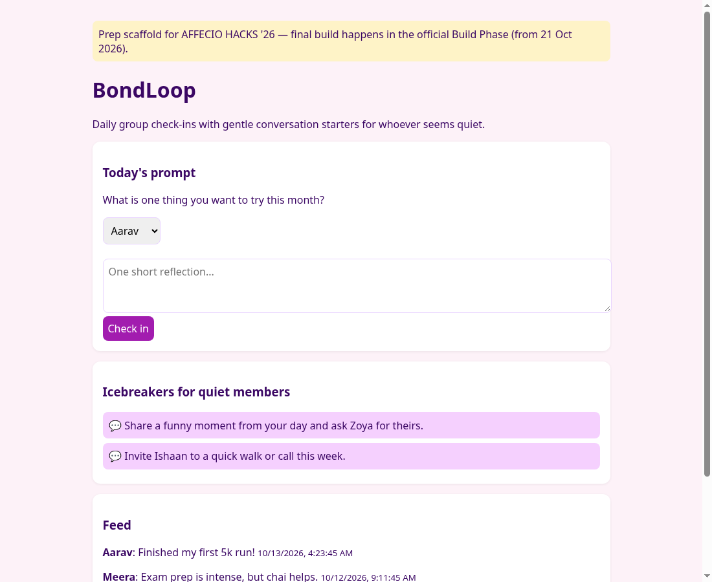

# BondLoop

> **Prep work notice:** This is a pre-event prep scaffold for **AFFECIO HACKS '26** (Affecio, Unstop). The official Build Phase opens **21 Oct 2026**; all substantive feature work for the submission will be done inside that window. Nothing here has been submitted.

A lightweight web app where a small group checks in with a daily prompt, shares one short reflection, and gets gentle conversation starters for members who seem quiet (no check-in in the last 2 days). Tracks: Human Connection / AI & Social Interaction / Communities.

**Demo:** http://edvera.me/bondloop/

## Run
No build step. Open `index.html`, or `python3 -m http.server 8000`. A fake 5-person group is seeded; data lives in localStorage ("Reset demo" restores it).

## AI
Currently an offline heuristic + template starters (`suggest()` in `app.js`). Planned for the build window: optional LLM call with this offline fallback, Next.js + SQLite backend, multi-device groups.
